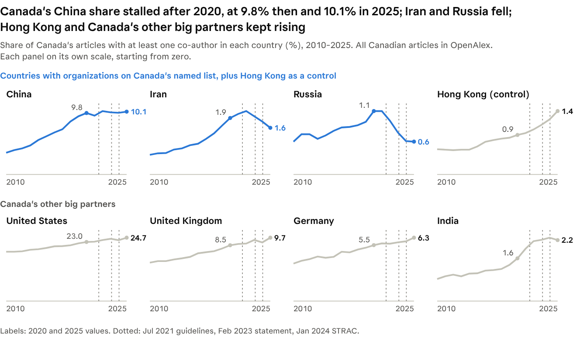
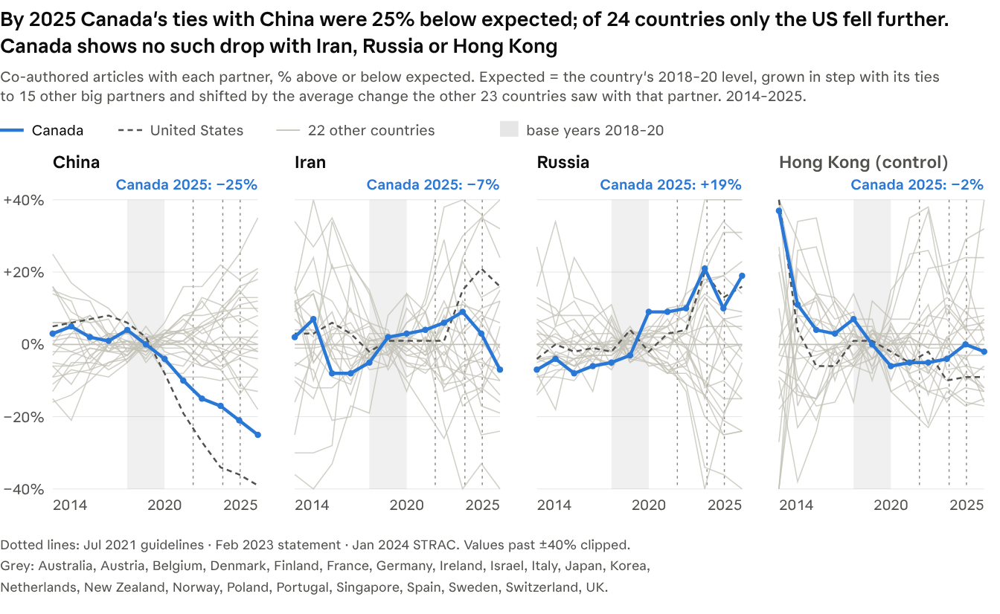
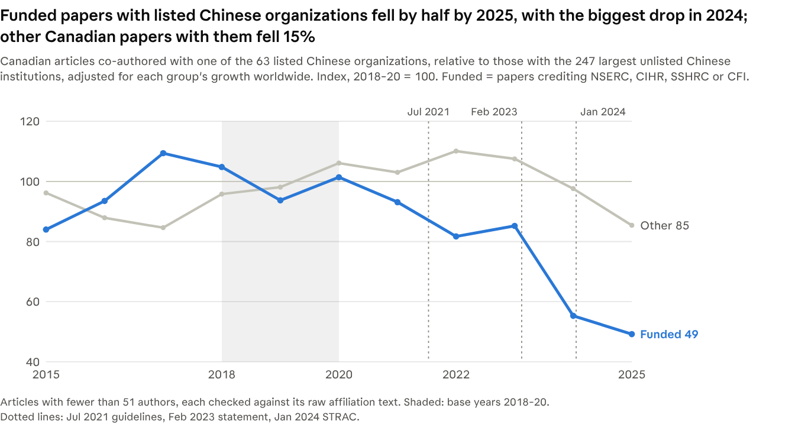
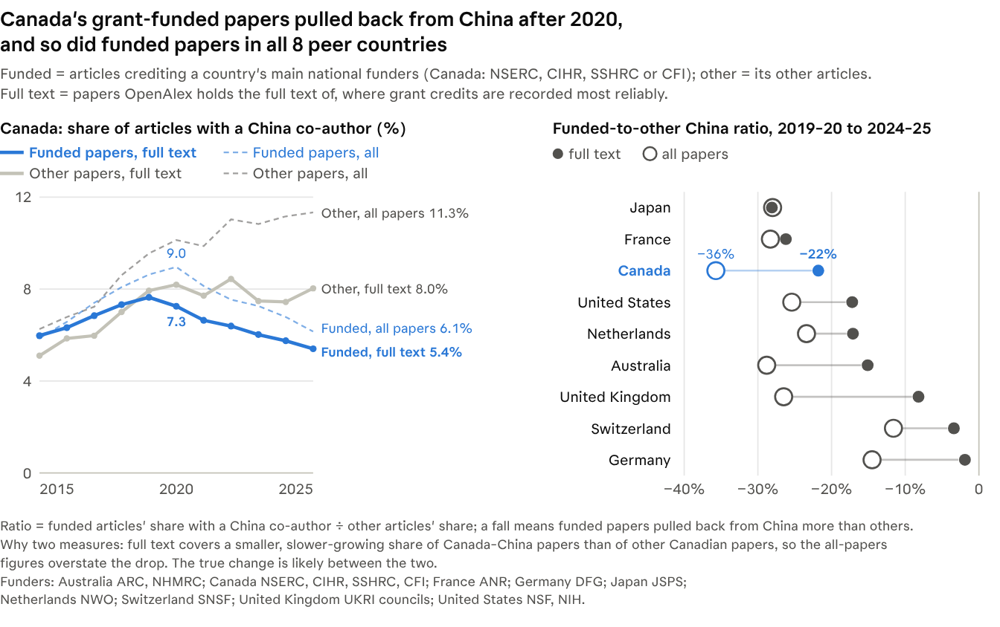
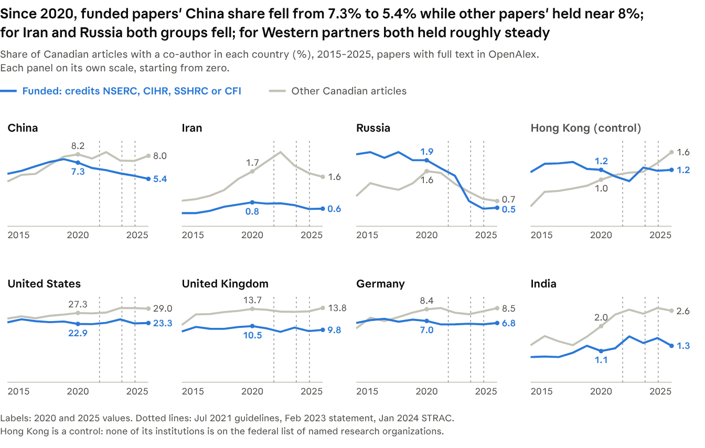
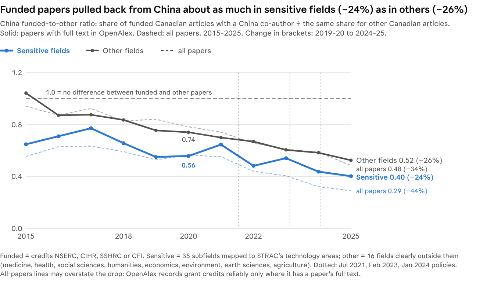
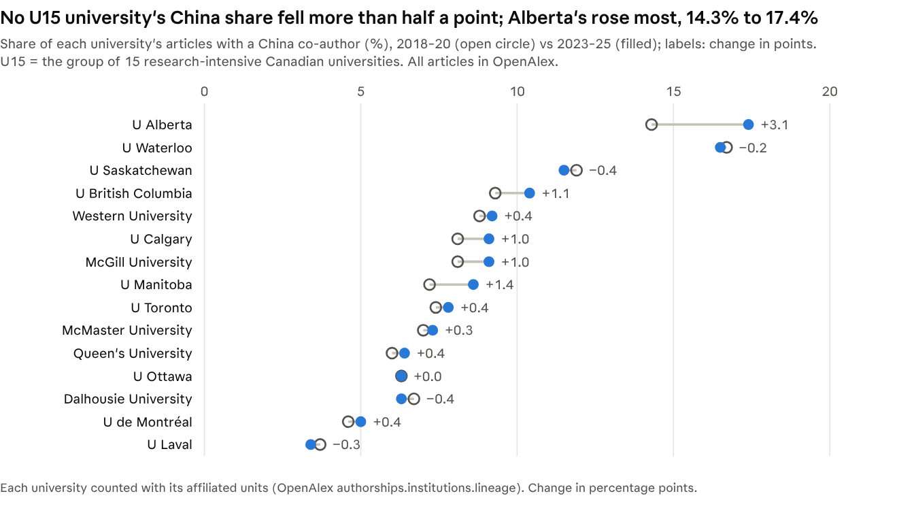

Has Canada's research security policy changed who Canadian researchers work with? I think it's a really interesting question, and obviously an important one, and open databases like OpenAlex can help inform it. Some say the rules are chilling collaboration with China. Others, including officials, say nothing much has changed. Both can't be right, so I wanted to see what I could find using OpenAlex.

Each section below takes one question people ask and walks through it the same way: how I looked at it, what I found, and what to keep in mind.

**The short version: Canada has pulled back from China more than most of its peers, and most sharply where the rules aim, at the listed organizations in sensitive fields.** But a lot of what changed is a Western-wide shift, and it started before the rules could have shown up in papers, so this data can't say how much is the policy and how much is the wider political climate.

- Canada-China co-authorship has stalled at about 10% of Canadian articles while most peers kept growing theirs. Compared with 23 other countries, Canada is about 23% below where you'd expect, second only to the US.
- The clearest sign of the rules: in sensitive fields, Canada's ties to the listed Chinese organizations (measured against its ties with other big Chinese institutions) fell 32% between 2018 to 2020 and 2024 to 2025, while the typical one of 23 other countries barely moved (down 4%). Canada kept pace with its peers until 2023, then fell well below them in 2024 and 2025. Outside sensitive fields, Canada's ties grew like everyone else's.
- Grant-funded papers pulled back from China more than other papers, but that happened in the UK, Australia, the US, Japan and France too. Canada's funded papers pulled back by between a fifth and a third, at the high end of that range but not clearly beyond it.
- Researchers who worked with listed organizations in 2015 to 2017 cut those ties on their funded papers by about two-thirds, against about two-fifths for a comparison group, and most of that extra drop came in 2024 and 2025.
- The overall slide began around 2019, during the diplomatic freeze over Meng Wanzhou and the two Michaels, and went on at a steady pace through 2025. The extra drop with listed organizations came in 2024 and 2025, as the federal list arrived.

*One grain of salt for everything here: this covers research in the open scholarly record. China keeps the metadata for much of its own domestic publishing out of that record, so if Canada-China work moved into venues visible only inside China, it wouldn't show up here.*

## First, the policies in a minute

Canada's measures came in three steps, and the binding parts only apply to federal research funding (the 2021 step covered just NSERC Alliance grants with private partners). STRAC only covers funding calls launched on or after 1 May 2024, so papers from those grants are just starting to show up. Most of what the data shows so far comes from the narrow 2021 screening, from researchers reacting to the 2023 statement and the 2024 announcement, and from the wider climate.

| Date | What happened |
| --- | --- |
| 1 May 2024 | STRAC takes effect for tri-agency funding calls; CFI phases it in fund by fund ([NSERC](https://nserc-crsng.canada.ca/en/news/important-changes-implementation-policy-sensitive-technology-research-and-affiliations-concern)) |
| 16 Jan 2024 | STRAC announced, with 11 sensitive technology areas and 103 [Named Research Organizations](https://science.gc.ca/site/science/en/safeguarding-your-research/guidelines-and-tools-implement-research-security/sensitive-technology-research-and-affiliations-concern/named-research-organizations) (85 in China, 12 in Iran, 6 in Russia) |
| May 2023 | Canada expels a Chinese diplomat over foreign interference; universities (Waterloo, Toronto, then UBC in November) announce Huawei exits |
| 14 Feb 2023 | [Ministers' statement](https://www.canada.ca/en/innovation-science-economic-development/news/2023/02/statement-from-minister-champagne-minister-duclos-and-minister-mendicino-on-protecting-canadas-research.html): sensitive research won't be funded if anyone on the team is affiliated with an institution connected to the military or state security of a foreign state that poses a national security risk |
| 30 Jan 2023 | The [Globe and Mail](https://www.theglobeandmail.com/politics/article-chinese-military-scientists-canadian-universities/) reports on Canadian co-authorship with Chinese military scientists |
| Feb 2022 | Russia invades Ukraine, and Western institutions suspend ties (not a Canadian policy) |
| 12 Jul 2021 | [National Security Guidelines for Research Partnerships](https://www.canada.ca/en/innovation-science-economic-development/news/2021/07/government-of-canada-takes-action-to-protect-canadian-research-and-intellectual-property.html): risk reviews for NSERC Alliance grants with private partners |
| May 2021 | Alberta pauses new university partnerships with PRC-linked entities |
| 2020 to 2022 | COVID travel limits, and China reforms how it evaluates research |
| Dec 2018 to Sep 2021 | Meng Wanzhou arrested in Vancouver; China detains Michael Kovrig and Michael Spavor until September 2021 (not a research policy, but the deepest Canada-China freeze in decades) |
| 4 Oct 2018 | CSIS warns the U15 universities' research vice-presidents about Huawei; made public in December |

Canada wasn't alone. The US, Australia, the UK, the Netherlands, Germany and the EU all tightened up over the same years. So when I compare Canada with those countries, I'm really asking how much further Canada moved than peers who were also acting.

**Which countries.** I focus on the three countries on the list (China, Iran and Russia) and compare them with Canada's other big partners. I also show Hong Kong on its own, as a control. It's a special administrative region of China, but none of its institutions is on the list.

## Has Canada pulled back from China at all?

**How I looked.** The simplest possible measure: the share of Canadian articles with at least one co-author at an institution in each country, every year from 2010 to 2025, plus 2026 so far.

**What I found.** Not really, at least not overall. The share of Canadian articles with a Chinese co-author nearly tripled between 2010 and 2020, then it just stopped growing: 9.8% in 2020, 10.1% in 2025. Iran peaked at 2.2% in 2022 and has dropped to 1.6%. Russia halved after the 2022 invasion. Meanwhile Hong Kong and Canada's Western partners kept climbing.

Source: OpenAlex API, type:article, institutions.country_code pairs, pulled 16 Nov 2026 · scripts/pull_pairs.py

2026 so far looks the same: China's share was about 10% for January to October in 2024, 2025 and 2026, while Iran's slid from 1.9% to 1.4%.

**Assumptions and caveats.** A flat line can hide a lot. China has grown enormously as a research power, so if Canada had kept pace, its China share should have kept rising. A paper counts as a collaboration if any author lists an institution in that country, so researchers with two affiliations count too. And the last year or two are still filling in. One more blind spot: China's two DOI registration agencies don't share their metadata openly, so many papers in Chinese journals are missing from OpenAlex ([one recent study](https://arxiv.org/abs/2512.16339) found it covers about a quarter of articles in China's core journals). Some collaboration could have moved into those venues, and as long as that data stays closed, we can't tell.

## Isn't everyone pulling back from China?

**How I looked.** For each country, I compared how much it co-authors with a partner against how much it co-authors with 15 other partners. Then I compared Canada's change with the same measure for 23 other countries across Europe, North America and the Asia-Pacific, taking 2018 to 2020 as the starting point. That strips out China's growth, Canada's general rise in international work, and anything everyone did, like stepping back from Russia after 2022.

**What I found.** Canada did pull back more than most. By 2024 and 2025 its co-authorship with China was about 23% lower than you'd expect. Against 23 other countries, only the US pulled back more (38%). Denmark, Norway, Austria and Australia fell 9 to 14%; the UK, Italy, Spain and others kept growing their China ties. The Canadian line started slipping around 2019 and slid every year after: 4% below expected in 2020, 10% in 2021, 17% in 2023, 25% in 2025.

Source: OpenAlex API, type:article, 24 countries, 2014–2025, pulled 19 Nov 2026 · scripts/pull_pairs_wide.py + did_wide.py

Nothing like this shows up for the other countries on the list. For Iran, Canada sits right in the middle of the 24 countries, and Canada actually held on to Russian ties better than most. Hong Kong, which I use as a control (it's part of China but none of its institutions is on the list), shows no change specific to Canada either.

**Assumptions and caveats.** Second of 24 is a strong hint, not proof: with this few countries, one could land that high by chance. The size of the gap is solid: dropping any one country leaves it between 22% and 25%, and in an earlier eight-country version it was about the same counting only smaller papers or only core journals. The peers tightened their own rules too, so this shows how much further Canada moved, not the whole effect of tightening. And comparing with peers can't remove things that only happened between Canada and China, like the diplomatic freeze from late 2018 to 2021.

## What about the named organizations?

The federal list names 103 specific organizations: Chinese defence universities and labs, plus some in Iran and Russia.

**How I looked.** I matched the listed organizations to institutions in OpenAlex, including units that sit under them in the institution hierarchy (affiliated hospitals that are separate institutions don't count). Then I counted Canadian papers with a listed Chinese organization against Canadian papers with one of the 247 biggest unlisted Chinese institutions, adjusted that ratio for how fast each group is publishing worldwide, and compared Canada's change with the same measure for 23 other countries. The comparison uses OpenAlex as it stands for every country. For the funded split and the researcher panel below, I also checked every Canadian paper linked to a listed organization against its raw affiliation text, with spot checks by hand, and submitted the mismatches I found as corrections to OpenAlex.

**What I found.** Yes, and this is the strongest result here. The list is aimed at sensitive technology, so I split the comparison by field. In sensitive fields, Canada's papers with listed organizations, relative to papers with unlisted Chinese institutions, fell 32% between 2018 to 2020 and 2024 to 2025 (somewhere between 27% and 36%, allowing for chance). The typical one of 23 other countries fell 4%. Only Ireland, with about a tenth as many of these papers, fell as far; among the countries with enough papers to measure well, Canada's drop is the biggest. Outside sensitive fields, Canada's ties grew 13%, in line with other countries. The timing fits too: until 2023 Canada's line moved with its peers', then in 2024 and 2025, as the list was announced and took effect, it fell well below them: 23% below the typical country in 2024 and 37% below in 2025.

| Sensitive fields: papers with a listed Chinese organization for every 100 papers with another big Chinese institution | 2018 to 2020 | 2024 to 2025 | Change, net of the worldwide trend |
| --- | --- | --- | --- |
| Canada | 33 | 20 | −32% |
| Netherlands | 30 | 21 | −24% |
| UK | 34 | 26 | −15% |
| US | 26 | 20 | −13% |
| France | 31 | 27 | −5% |
| Germany | 28 | 25 | −2% |
| Australia | 27 | 25 | −2% |
| Japan | 23 | 22 | +4% |
| Typical of the 23 other countries |  |  | −4% |

Outside sensitive fields the ratio is much lower, and Canada's rose from 9 to 10 per 100 (up 13% net of the worldwide trend), like most countries'. The worldwide trend: listed organizations' own output grew about 9% slower than the other institutions' in sensitive fields, so a few points of every country's drop are global rather than national.

Source: OpenAlex API, type:article, papers co-authored by each of 24 countries and China, 2015–2025, pulled 20 Nov 2026 · scripts/nro_field_works.py; mapping data/nro_map.csv

Splitting by funding points the same way. Funded Canadian papers with a listed Chinese organization fell from 397 in 2020 to 120 in 2025, half their earlier level once you account for growth, and the biggest drop came in 2024, the year the list came out. Other papers fell about 15%.

Source: Local download of 1.11M Canadian articles 2015–2025 (fewer than 51 authors), pulled 18 Nov 2026 · scripts/pull_ca_works.py + author_panel.py + nro_funded_split.py

**Assumptions and caveats.** Some peers fell in sensitive fields too (the Netherlands, the UK and the US by 13 to 24%), so part of this is a broader Western step back from China's defence-linked universities, and some of it started early: Canadian links with the National University of Defense Technology fell from 71 in 2018 to 27 in 2023, before the list existed. Fewer links could also mean researchers stopped listing a listed affiliation rather than stopped working together, since affiliations are exactly what the rules ask about. My field split uses OpenAlex's topic labels, which is looser than what the rules cover; dropping medicine, neuroscience and pharmacology from the "other fields" group doesn't change the picture. Matching names to OpenAlex records needed care: about 1% of China matches were wrong, split between affiliation strings that didn't name the organization and duplicate records. For Iran, a mix-up between Shahid Beheshti University and its separate medical university made 28% of matches wrong, so I make no claims about Iran's listed organizations. Russia's six entries are too small to measure. I count each paper once, whichever listed or unlisted organizations are on it; counting institution links instead makes every drop look bigger (Canada's would be 42%).

## Is it the policy, or just the mood?

Plenty else changed after 2020: COVID, fewer visiting students from China, tense diplomacy. So how do we know any of this has to do with research security policy?

**How I looked.** The rules only reach federally funded research. So I split Canadian papers by whether they credit NSERC, CIHR, SSHRC or CFI, and compared the two groups. If the mood had shifted for everyone, both groups would move together. If the rules were driving this, papers funded by those agencies should pull back from China and other papers shouldn't, and that shouldn't happen in countries without the rules. So I ran the same comparison for eight peers using their own national funders.

**What I found.** In Canada it's the funded papers that moved. Among them, the share with a Chinese co-author fell from 9.0% in 2020 to 6.1% in 2025, while among everything else it rose from 10.1% to 11.3%. Part of that gap is how grant credits get recorded (see the caveats below). Counting only papers whose full text OpenAlex has, where credits are recorded reliably, the funded share fell from 7.3% to 5.4% while the rest held at about 8%. Either way, funded papers pulled back from China relative to other papers, by between a fifth and a third. But this turns out not to be a Canadian story: the same happened in every peer country I checked. On all papers, Canada's drop (36%) is the biggest of nine countries; on full-text papers it is 22%, Japan (28%) and France (26%) fell further, and the typical peer fell 16%. So most of this is a shift shared across Western countries, with Canada at the high end, and this test can't pin it on Canada's rules.

Source: OpenAlex API, type:article, funders.id (tri-agency/CFI for Canada; peers' own national funders), full-text papers and all papers, pulled 20 Nov 2026 · scripts/funded_fulltext.py

Within Canada, funded papers have drifted away from lots of partners, not just China: on full-text papers, the typical drop in the funded-to-other ratio across 19 partner countries is about 14%. The drop is bigger for China (22%), Iran (24%), Hong Kong (38%) and Russia (49%) than for the US, the UK and Germany (7 to 8%), and China's had already begun before 2020. Hong Kong has no listed organizations, so this looks like broad caution about Chinese ties on grant-funded work rather than a response to the list.

Source: OpenAlex API, type:article, papers with full text, funders.id NSERC/CIHR/SSHRC/CFI, pulled 20 Nov 2026 · scripts/funded_fulltext.py

**Assumptions and caveats.** The gap opened in 2021 and 2022. That's too early for the 2021 guidelines, which only covered NSERC Alliance grants with private partners, to show up in papers, and far too early for STRAC. It does line up with the deepest Canada-China freeze in decades: Meng Wanzhou's arrest in December 2018 and China's detention of Michael Kovrig and Michael Spavor until September 2021, followed by the 2023 foreign interference affair. I can't separate the policy from that climate. The "other" group isn't fixed either: more Canada-China papers are now led from China, and those rarely credit a Canadian grant. That shift explains roughly a third of the drop. This also leans on grant credits as OpenAlex records them. Funder data on Canada-China papers dipped in 2021 to 2024, but looking only at papers that credit some funder gives the same answer (Canadian grants on 28% of them before, 19% after). The bigger issue: where OpenAlex has a paper's full text, it catches more than nine in ten tri-agency credits, but it has full text for a smaller and slower-growing share of Canada-China papers than of other Canadian papers. So I ran these comparisons twice, on all papers and on papers with full text. The full-text group has its own tilt (funded Canada-China papers have become more likely to have full text), so the truth is probably in between: a pullback of about 30%.

## Is it about the sensitive stuff?

The rules target sensitive technology, things like AI, quantum, aerospace and advanced materials.

**How I looked.** I matched OpenAlex's subject areas to the 11 areas on STRAC's sensitive technology list, then compared sensitive fields with fields clearly outside the list (health, social science, earth and environmental science and so on; I left out chemistry, mathematics and other fields that sit in between), for funded and other papers.

**What I found.** China is a big partner in Canada's sensitive research: in 2025, 21% of Canadian articles in those fields had a Chinese co-author, against 7% elsewhere. Across funded and unfunded papers together, the pullback was about the same in sensitive and other fields. Among funded papers, it looks bigger in sensitive fields when you count every paper (the funded-to-other ratio fell from 0.57 in 2020 to 0.29 in 2025, against 0.78 to 0.48 elsewhere). But on full-text papers, where grant credits are recorded reliably, the two fell by about the same amount, roughly a quarter each. So the funded pullback isn't about the technologies the rules name.

Source: OpenAlex API, type:article, primary_topic subfields mapped to STRAC areas, full-text papers and all papers, pulled 20 Nov 2026 · scripts/funded_fulltext.py

**Assumptions and caveats.** Matching OpenAlex's fields to STRAC's sensitive technology areas is a coarse first pass. It's broader than the specific technologies on the list, which waters the effect down rather than inflating it, and in the listed-organization test, leaving medicine, neuroscience and pharmacology out of the comparison fields doesn't change the result. But anyone doing this properly, Canada included, should build a classifier that captures what each sensitive area actually means. Iran shows a similar but noisier dip.

## Did the same researchers change what they do?

Paper counts can shift because people retire, move or change fields, so it's worth following the same people over time.

**How I looked.** I downloaded every Canadian article from 2015 to 2025 (1.11 million, leaving out giant team papers) and followed two groups of Canadian-based researchers, picked on what they did in 2015 to 2017, well before any of the rules:

- **2,587** who published with a listed Chinese organization in 2015 to 2017.
- **10,994** who published with the big unlisted Chinese institutions in those years, but never with a listed one. This is the comparison group.

Then I compared how often their funded and unfunded papers involved their Chinese partner type in 2018 to 2020 and in 2023 to 2025. Picking people in one period and measuring them in later ones matters: anyone picked for collaborating in a given window will collaborate less afterwards (students graduate, projects wrap up), and my first version of this mixed the two up and overstated the effect.

**What I found.** Both groups pulled back on funded papers, but the first group much more. Their share of funded papers with a listed organization fell from 11.9% to 4.1%, while the comparison group's share of funded papers with unlisted Chinese institutions fell from 15.3% to 9.6%. Relative to the comparison group, their share ended about 45% lower (somewhere between 26% and 59%, allowing for chance and for researchers at the same university moving together). On their unfunded papers the difference was small and could be chance (12%).

| Share of the group's papers with its Chinese partner type | 2018 to 2020 | 2023 to 2025 |
| --- | --- | --- |
| Listed-organization group, funded papers | 11.9% | 4.1% |
| Comparison group, funded papers | 15.3% | 9.6% |
| Listed-organization group, unfunded papers | 12.6% | 10.0% |
| Comparison group, unfunded papers | 20.6% | 18.7% |

No sign of an exodus either: 57% of those who worked with listed organizations in 2018 to 2020 were still publishing from Canada in 2023 to 2025, about the same as those who worked only with unlisted Chinese institutions in those years (53%). Most of those who weren't now list an institution in China, likely many students and postdocs heading home.

**Assumptions and caveats.** This depends on OpenAlex linking each paper to the right person; restricting to researchers with an ORCID ID gives the same answer (44%). The comparison group also pulled back on funded papers, which is the Western-wide shift again; the listed-organization effect is what's left on top. But peers also stepped back from these organizations, and running the same comparison on years before 2021 already shows a gap of about 20 to 25%, so part of this isn't about the rules at all. Papers trail grants by one to three years, so grants under STRAC are only starting to show up.

## Did they stop the work, or just stop crediting the grant?

If someone kept doing the same grant-funded work with a listed organization but quietly dropped the acknowledgement, the papers would look exactly like this.

**How I looked.** I matched researchers to their grants (NSERC's open awards data, plus CIHR, SSHRC and CFI awards in OpenAlex) by name and institution, and checked whether papers with a listed organization that don't credit a Canadian grant look like the author's funded work: same field, same Canadian team.

**What I found.** This test can't settle it. Papers that look like funded work with the credit missing were about 12% of these papers in 2018 to 2020 and 10% in 2023 to 2025, against 9% and 11% in the comparison group, so there's no sign of a wave of hidden crediting. But researchers matched to a grant just as often whether or not the paper credited one, so the test can't really tell funded work from unfunded work.

**Assumptions and caveats.** Matching people to grants by surname, first initial and institution misses some and gets some wrong, especially for common surnames. I'd treat this question as open.

## Are universities cutting ties?

**How I looked.** The share of each U15 university's articles with a Chinese co-author, 2018 to 2020 against 2023 to 2025, plus the same by field.

**What I found.** No. No U15 university's China share fell by more than half a point, and most went up. Alberta went from 14.3% to 17.4%, despite the province's 2021 pause on new partnerships with PRC-linked entities. No university cut its overall China ties. The drop sits in funded papers and listed organizations, which I didn't break down by university.

Source: OpenAlex API, type:article, 2018–20 vs 2023–25, pulled 16 Nov 2026 · scripts/pull_where.py

By field, the China share slipped in energy and materials science and held flat in computer science, while it grew in medicine, the social sciences and business.

**Assumptions and caveats.** University totals mix funded and unfunded work and many fields, so they can hide the shifts above. Alberta's provincial pause covered formal partnerships, not individual co-authorship.

## Who's leading the work?

**How I looked.** In most sciences the first author did most of the work and the last author is the senior lead, and the corresponding author is usually whoever runs the project. So for every Canada-China article from 2015 to 2025, I checked whether the first, last and corresponding authors were at a Canadian institution, a Chinese one, or both (people who list an institution in each country). Canada-US papers are the baseline.

**What I found.** The work has drifted toward China. On Canada-China papers, the first author was at a Chinese institution only on 55% of papers in 2015 to 2017, 58% in 2018 to 2020 and 64% in 2023 to 2025. Canadian last authors slipped from 35% in 2015 to 30% in 2025. The biggest change is the disappearing dual affiliation: first authors listing both a Canadian and a Chinese institution fell from 17% in 2018 to 2020 to 10% in 2023 to 2025. On Canada-US papers, who comes first barely moved, though dual affiliations fell there too (from 7% to 5% of first authors), so part of that change is general.

Funded papers are the exception. When a Canada-China paper credits a Canadian grant, a Canadian is the last author 53 to 58% of the time, every year, before and after the rules. On papers with a listed organization, the shift is starkest: a Chinese-only first author went from 62% in 2018 to 2020 to 75% in 2023 to 2025, and dual affiliations from 19% to 9%.

| First author's institution | 2015 to 2017 | 2018 to 2020 | 2023 to 2025 |
| --- | --- | --- | --- |
| Canada-China papers: China only | 55% | 58% | 64% |
| Canada-China papers: both countries | 17% | 17% | 10% |
| Papers with a listed organization: China only | 58% | 62% | 75% |
| Papers with a listed organization: both countries | 21% | 19% | 9% |
| Canada-US papers: Canada only | 34% | 32% | 31% |

Adding the corresponding author tells the same story, a bit more sharply. A Canadian is the corresponding author on 35% of Canada-China papers in 2023 to 2025, down from 42% in 2018 to 2020; on Canada-US papers it barely moved (42% to 40%). Counting a paper as Canadian-led when the first, last or corresponding author is in Canada:

| Canadian-led (first, last or corresponding author) | 2018 to 2020 | 2023 to 2025 |
| --- | --- | --- |
| Canada-China papers | 60% | 53% |
| Papers with a listed organization | 63% | 52% |
| Canada-US papers | 56% | 53% |

Put together with the earlier sections: the funded, Canadian-led work with China shrank, and what's left is increasingly China-led work with a Canadian co-author, and fewer people straddling both countries.

**Assumptions and caveats.** Author order means different things in different fields (some list authors alphabetically), so this is a rough guide to who's in charge. OpenAlex marks a corresponding author on about 80% of these papers, so that measure has gaps too, and Canada-US papers drifted a little as well, so only part of this is about China. Some of the drift would happen anyway as China's research system grows. And fewer dual affiliations could mean fewer people holding posts in both countries, or just fewer people listing them, which matters because undisclosed affiliations are exactly what the rules ask about.

## What happened with Huawei?

Huawei isn't on the federal list, but it was a major corporate funder of Canadian university research (an estimated $50 million to 13 universities by 2018, [as reported at the time](https://thelogic.co/briefing/canadas-spy-agency-cautions-universities-about-research-ties-with-huawei/)), and universities handled it very differently. Waterloo announced in May 2023 that it would end its Huawei partnership once its current contracts ran out that year. Toronto stopped new agreements in April 2023. UBC said in November 2023 it wouldn't take on new Huawei projects. But not every university made a public statement, and the question still stands: which of them might have kept working with Huawei?

**How I looked.** Three ways. First, Canadian papers that list Huawei as a funder in OpenAlex, and papers with a Huawei co-author. Second, NSERC's open data on which grants had Huawei as a partner. Third, and this turned out to matter most, the acknowledgements themselves. I started with SFU and UBC, the two universities closest to me, both strong in computer science and engineering, and then widened it to all of Canada: every Canadian paper from 2016 to 2025 whose full text in OpenAlex mentions Huawei (1,694 of them when I pulled them), keeping the 471 whose acknowledgements say Huawei paid for or supported the work.

**What I found.** Huawei was clearly investing in a lot of projects at Canadian universities. The acknowledgements name the Waterloo-Huawei Joint Innovation Lab, the University of Alberta ECE-Huawei Research Initiative, the Huawei-SFU Visual Computing Joint Lab, the Huawei-UBC Joint Lab, the Huawei Cloud Database Innovation Lab, Huawei's Noah's Ark Lab, the Huawei Innovation Research Program and NSERC/Huawei research chairs, plus plenty of plain grants and gifts from Huawei Technologies Canada. OpenAlex's funder list catches only about one in five of these papers (90 of 471), so counting by funder alone badly undercounts.

Nationally, papers thanking Huawei grew from a handful a year in 2016 to 90 in 2022 and 89 in 2023, then fell to 59 in 2024 and 29 in 2025. Most universities fell 60 to 85% between 2022 to 2023 and 2024 to 2025, including the ones that announced they were stepping back (Toronto, UBC, McGill) and Waterloo, which ended its partnership. Two fell much less: the University of Alberta, which declined to comment in 2023 and where the ECE-Huawei Research Initiative keeps showing up, and the University of Ottawa, a short drive from Huawei's Kanata research centre. SFU, which made no public statement I could find, fell like the rest. None of this broke a rule: working with Huawei has stayed legal, and no federal research-security rule names it.

| Papers thanking Huawei for support | 2020 to 2021 | 2022 to 2023 | 2024 to 2025 | Public stance |
| --- | --- | --- | --- | --- |
| Waterloo | 25 | 42 | 16 | Exit announced May 2023; contracts ended that year |
| Toronto | 34 | 34 | 12 | No new agreements, April 2023 |
| Alberta | 9 | 23 | 19 | Declined to comment, 2023 |
| UBC | 16 | 17 | 3 | No new projects, November 2023 |
| Carleton | 10 | 14 | 4 | No active agreements (May 2023) |
| McGill | 5 | 19 | 6 | No further contracts, winter 2022 to 2023 |
| Ottawa | 9 | 13 | 9 | None found |
| Polytechnique Montréal | 2 | 11 | 4 | None found |
| SFU | 5 | 10 | 2 | None found |

The warnings started much earlier than the rules. CSIS briefed the U15 universities' research vice-presidents about Huawei on 4 October 2018, and the Globe made it public that December, days after Meng Wanzhou's arrest. Universities mostly carried on: Queen's accepted Huawei funding for a new project the next month. And the grants show it. NSERC co-funded 132 grants with Huawei as a partner between fiscal 2012 and fiscal 2020, nearly half at Toronto and Waterloo, and new ones *peaked* in fiscal 2019, the year after the CSIS warning, at 33, most of them in the last round of NSERC's old industry-partnership program. Then they halved in fiscal 2020, along with all NSERC industry partnerships as NSERC switched to its new Alliance program, and none started from fiscal 2021 (April 2021) on, at any university. Industry Minister François-Philippe Champagne later [told the House science committee](https://www.ourcommons.ca/Content/Committee/441/SRSR/Evidence/EV12721456/SRSREV65-E.PDF) there had been no federal grants to Huawei since June 2021, just before the 2021 guidelines took effect. So federal co-funding ended in 2021, but Huawei's own money kept flowing to universities until their 2023 statements: Toronto had about 150 Huawei-sponsored projects [in 2022](https://universityaffairs.ca/news/huawei-ban-adds-to-concerns-of-a-chill-effect-in-research-over-national-security-rules/), and UBC had $6.3 million across 24 Huawei projects [in 2021 to 2022](https://ubyssey.ca/news/ubc-huawei-partnership-not-yet-directly-impacted-after-canada-bans-company-from-5g-network/). That is when the acknowledgements drop. Across Canada, papers listing Huawei as a funder peaked at 53 in 2023 and fell to 12 in 2025.

What didn't stop is working alongside Huawei's own researchers. About 250 Canadian papers a year still have a Huawei co-author, the same as in 2021, much of it from Huawei Canada's own research labs.

**Assumptions and caveats.** OpenAlex has full text for about half of Canadian articles, and about a third in computer science and engineering, where most of these papers are, so these counts are a floor, and they're small enough that one lab can move a university's number. A paper counts for every Canadian university on it, including through the university's own institutes. Papers trail funding by one to three years, so money taken after the 2023 statements would only start to show in 2025 and 2026 papers, and 2025 is still filling in. I dropped mentions that weren't Huawei paying for Canadian research: long lists of a foreign lab's industry donors, people disclosing that they consult for or work at Huawei, and Chinese programs. An acknowledgement also doesn't say when the money was given. No federal research-security rule names Huawei; the federal lever was NSERC no longer co-funding Huawei partnerships from 2021.

## Do the provinces matter?

Provinces fund research too, and some acted on their own. Alberta paused new university partnerships with PRC-linked entities in 2021, and Ontario has run security reviews on its research funding since 2019.

**How I looked.** I placed each Canadian article in the province of each Canadian author's institution (federal labs count in their own province, not their department's), then compared the share with a Chinese co-author in 2018 to 2020 and 2023 to 2025, split by whether the paper credits a federal grant.

**What I found.** The federal pattern shows up in every big province: the share of funded papers with a Chinese co-author fell more than the share of other papers. Quebec's funded share fell most, from 5.0% to 3.1%, while its other papers' share rose. Alberta is the surprise: its funded share barely moved (6.1% to 5.7%), about the same as its other papers. If the 2021 pause did anything, it doesn't show in co-authorship. Funded papers with listed organizations fell in every province in the table, Alberta included.

| Province | Funded papers with a Chinese co-author | Other papers with a Chinese co-author | Funded papers with a listed organization |
| --- | --- | --- | --- |
| Ontario | 6.4% → 4.7% | 7.6% → 7.0% | 486 → 208 |
| Quebec | 5.0% → 3.1% | 4.6% → 5.3% | 248 → 101 |
| British Columbia | 6.2% → 4.8% | 7.8% → 7.6% | 110 → 68 |
| Alberta | 6.1% → 5.7% | 7.7% → 7.3% | 176 → 99 |
| Saskatchewan | 7.5% → 6.9% | 10.5% → 8.7% | 31 → 14 |
| Manitoba | 5.8% → 3.5% | 6.1% → 6.6% | 37 → 20 |
| Nova Scotia | 5.3% → 3.4% | 6.9% → 4.9% | 39 → 20 |

*2018 to 2020 → 2023 to 2025. Shares are on papers with full text in OpenAlex, where grant credits are recorded reliably; listed-organization counts are totals over each three-year span, on all papers.*

**Assumptions and caveats.** Alberta's pause covered formal university partnerships, not individual co-authorship, so a flat line doesn't mean it was ignored. A paper with authors in two provinces counts in both. The smaller provinces have few papers, so their numbers jump around.

## What none of this can tell us

- **Patterns, not proof.** The different tests agree on direction and timing, but none of them is a controlled experiment. COVID, fewer Chinese visiting students and China's own policy changes all landed in the same years.
- **Co-authorship isn't partnership.** None of this sees grant denials, projects that never got started, informal advice, or researchers deciding not to pursue something.
- **It depends on what papers record.** Affiliations and grant acknowledgements are only as good as what authors and publishers report, and the newest years are still filling in.
- **Policy or climate?** Comparing with other countries strips out what everyone went through, but not what only happened between Canada and China. The diplomatic freeze from 2018 to 2021 and the 2023 foreign interference affair landed in the same years as the rules, and this design can't pull them apart.
- **Stopped listing isn't stopped working.** The rules ask about affiliations, so some drop in listed-organization links could be researchers no longer listing a second affiliation rather than ending the work.

## What I haven't looked at yet

A few angles that would sharpen this, roughly in order of how much they'd add:

- **Is it the Canadian list, or caution about China's defence sector in general?** Compare Chinese organizations on the US Entity List but not on Canada's list. If Canadian ties to those also dropped, it's general caution; if not, it's the Canadian list.
- **People moving.** Fewer researchers arriving from China, or leaving Canada, would change collaboration without anyone deciding anything. Affiliation histories can show the flows.
- **The 2026 update.** Grants under STRAC started in mid-2024; their papers will start showing up in 2026 and 2027.

## How I did it

Apart from Huawei, where I counted every type of work, all counts are articles (98% of them in journals) in [OpenAlex](https://openalex.org), pulled between 16 and 20 November 2026, so later pulls will differ a little as OpenAlex updates. Where a result depends on grant credits, I show it on all papers and on papers with full text in OpenAlex, where credits are recorded most reliably. A paper counts as a collaboration with a country when at least one author lists an institution there. Grants come from NSERC's open data and OpenAlex's award records. Where OpenAlex matched an affiliation to a listed organization it doesn't name (most often confusing Shahid Beheshti University with its separate medical university), I submitted 763 corrections to OpenAlex on 19 November. They fix those papers for everyone who uses OpenAlex, though the same mix-up still affects many papers with no Canadian author. Since I work at OpenAlex, I want to be upfront that those corrections change the data I'm reporting on, mostly for Iran, which is one more reason I don't lean on the Iran numbers. I left the mismatched papers out of this analysis.

**Data and code:** [this folder](https://github.com/kyledemes-pesonal/kyledemes-site/tree/main/data/2026-research-security) has the numbers behind each chart, the matching of all 103 named organizations to OpenAlex, the policy timeline with sources, and the Python behind it all. You can also check the headline numbers yourself in a browser. [Canadian articles in 2025 by partner country](https://api.openalex.org/works?filter=type:article,institutions.country_code:CA,publication_year:2025&group_by=institutions.country_code) shows the total in the CA row and the papers with a Chinese co-author in the CN row (10.1%). [The same for papers crediting a tri-agency or CFI grant](https://api.openalex.org/works?filter=type:article,institutions.country_code:CA,publication_year:2025,funders.id:F4320334593|F4320334506|F4320334617|F4320319952|F4320320995&group_by=institutions.country_code) gives 6.1%. Change 2025 to 2020 in either link to see the starting point.
