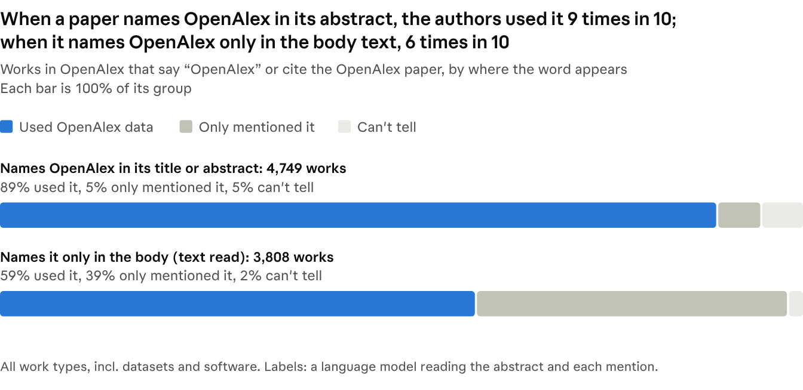
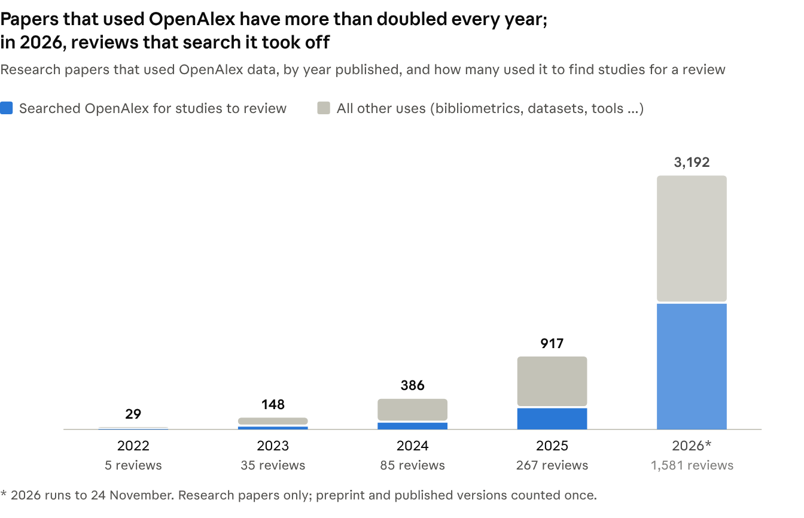
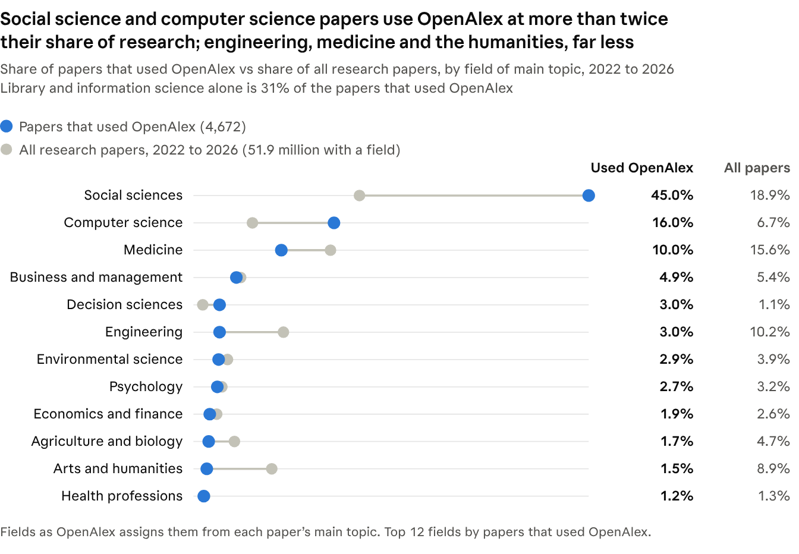

## The short version

- I found **4,672 research papers** that used OpenAlex since it launched in 2022. The real number is probably 7,500 to 9,000.
- **Use more than doubles every year.** This year, half of these papers are reviews that searched OpenAlex for studies.
- **Only about 1 in 4 of them cite OpenAlex.** Citations miss most users.
- **Dutch, Swiss, German and Canadian researchers** use it most for their size, among countries that publish a lot.
- **Two different sets of funders.** The funders behind the research that uses OpenAlex are mostly not the ones paying for OpenAlex.

## How do you find papers that used OpenAlex?

Citations miss most users: only about 1 in 4 papers that used OpenAlex cite the [paper that describes it](https://openalex.org/W4229010617). A text search has the opposite problem. It also catches papers that just mention OpenAlex in passing.

So I did both. I found every work in OpenAlex that says "OpenAlex" or cites that paper, 9,768 in all. Then a language model read each mention and answered one question: did the authors actually use it?

Source: OpenAlex API, 24 Nov 2026 · 8,557 works with a readable mention (1,211 with no readable copy not shown)

Where the word sits tells you a lot. In an abstract it almost always means use. Deep in the body text, it's only a bit better than a coin toss.

## How fast is it growing?

Source: OpenAlex API, 24 Nov 2026 · 4,672 research papers that used OpenAlex

From 148 papers in 2023 to 3,192 so far this year. It isn't just OpenAlex holding more papers, and it isn't a few prolific authors: leave out anyone with five or more of these papers in a year and 2026 is still more than three times 2025.

Most of the 2026 jump is reviews. 1,581 papers this year used OpenAlex to find studies for a review, up from 267 last year. Why? It could be review guidance, AI tools that search OpenAlex for authors, or people leaving paid databases. I can't tell yet, and I'd love to know.

## Who uses it, and for what?

Researchers in 134 countries. The US, China and Brazil write the most of these papers. But for how much they publish, Dutch, Swiss, German and Canadian researchers use OpenAlex about twice as much as you'd expect, and Chinese and Indonesian researchers well under.

Source: OpenAlex API, 24 Nov 2026 · 3,568 papers that used OpenAlex and have a known author country

Library and information science, the home of bibliometrics, makes up 31% of the papers. The rest come from almost every field, with computer science well ahead of its size and medicine, engineering and the humanities well behind.

Source: OpenAlex API, 24 Nov 2026 · 4,672 papers that used OpenAlex vs all research papers 2022 to 2026

The two most common uses are finding studies for a review (42%) and counting or mapping publications, citations and collaborations (29%). The rest link OpenAlex to other data, build datasets or tools on it, or study OpenAlex itself.

## Who pays for OpenAlex, and who pays for the research that uses it?

About half of OpenAlex's money comes from grants, from Arcadia, Wellcome, the Navigation Fund and Schmidt Sciences. The other half comes from members and customers. The 139 listed members are mostly universities, plus a few research funders and companies.

The research that uses OpenAlex is paid for by a different crowd. The 615 papers that list their grants name 1,427 of them, and 95% come from funders that don't pay for OpenAlex: EU programmes, the national science foundations of the US and China, and funders in Germany, Spain and Brazil.

Source: OpenAlex award records on papers that used OpenAlex (24 Nov 2026); OpenAlex grant announcements, supporters page and US tax filing

That's how open infrastructure is meant to work: anyone can use it. It still leaves me curious whether research funders see shared tools like this as part of the research they pay for.

## What this can't tell us

- **How much anyone relies on OpenAlex.** A review that ran one search counts the same as a study built on it.
- **Use that never becomes a paper.** Rankings, dashboards, library tools, companies and AI tools use OpenAlex without writing about it.
- **Papers I couldn't read.** OpenAlex holds full text for under half of recent papers, and I couldn't get a readable copy of 1,136 more. That's why the true count is likely 7,500 to 9,000.

## How I did it

- On 24 November 2026 I searched OpenAlex for works whose text says "openalex" ([9,578](https://api.openalex.org/works?filter=fulltext.search:openalex&corpus=all)) or that cite the OpenAlex paper ([1,477](https://api.openalex.org/works?filter=cites:W4229010617&corpus=all)): 9,768 works.
- Where the abstract didn't name OpenAlex, I read the passages around each mention in an open copy.
- Claude Haiku labelled each work as used or only mentioned. Claude Opus relabelled 200 at random and agreed on 194.
- I kept research papers from 2022 to 2026, counting preprint and published versions once, and compared them with all research papers from the same years.
- Grants come from the award records OpenAlex holds for each paper. OpenAlex's own funding comes from its grant announcements, [supporters page](https://openalex.org/institutional-supporters) and [US tax filing](https://projects.propublica.org/nonprofits/organizations/461599252).
- **Data and code:** [this folder](https://github.com/kyledemes-pesonal/kyledemes-site/tree/main/data/2026-who-uses-openalex) has the scripts, the aggregate results and a manifest that maps every number to its script.
