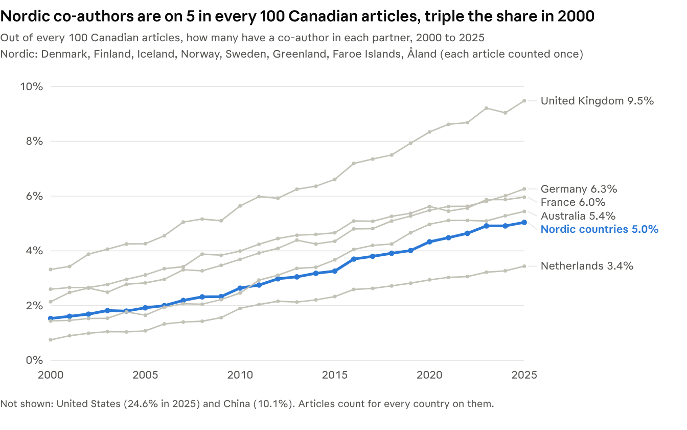
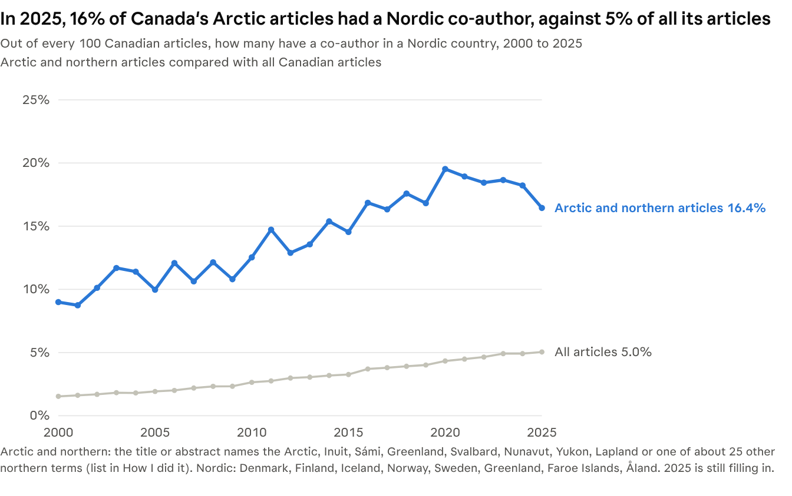

In March 2026, Canada's prime minister sat down with all five Nordic prime ministers in Oslo, and most of the statements Canada has signed with Nordic governments since late 2025 mention research. So I wanted to know how much Canadian and Nordic researchers already work together, on what, and whether that lines up with what the governments now say they want.

**The short version: Canada and the Nordic countries already work together a fair amount, most of all on the North, where the ties grew up on their own over decades. The newer priorities (quantum, AI, connectivity, clean energy and space technology) haven't grown that way yet, and that's where the new joint support could do the most.**

- In 2025, 5 in every 100 Canadian articles had a Nordic co-author, about three times the share in 2000. That growth kept pace with Canada's other European ties rather than outrunning them.
- The North is the core: 16% of Canada's Arctic and northern articles had a Nordic co-author in 2025, three times the overall rate.
- Quantum, AI, connectivity, clean energy and space technology run at 2 to 3 in every 100 Canadian articles, below the overall rate of 3.9. These are also the areas where joint support is newest: NordForsk's first call with Canada was in 2024, and a joint quantum call followed in 2026.
- The Nordic countries keep national research records and are moving their national bibliometrics to open data. With Canada's new open access policy starting in 2027, that's a practical place to compare notes.

## Why now?

Canada and the Nordic countries have worked together on the Arctic since the 1990s, when Canada hosted the founding of the Arctic Council. What changed after 2022 is the pace. Russia's invasion of Ukraine froze the Arctic Council and brought Finland and Sweden into NATO, and US pressure on Greenland in early 2026 pushed Canada and the Nordic countries closer still. Between November 2025 and October 2026, Canada signed a joint statement or agreement with every Nordic government, among them [Sweden](https://www.pm.gc.ca/en/news/statements/2025/11/18/joint-statement-prime-minister-carney-and-prime-minister-kristersson), [Denmark on quantum](https://www.canada.ca/en/innovation-science-economic-development/news/2025/11/governments-of-canada-and-denmark-sign-joint-statement-on-quantum-cooperation.html), [Norway on research](https://www.canada.ca/en/innovation-science-economic-development/news/2026/03/canada-norway-joint-statement-on-research-cooperation.html), [Finland](https://www.pm.gc.ca/en/news/statements/2026/04/14/joint-statement-prime-minister-canada-mark-carney-and-president-republic) and the [Oslo leaders' statement](https://www.pm.gc.ca/en/news/statements/2026/03/15/joint-statement-prime-ministers-nordic-countries-and-canada). Research is written into most of them.

Looking across 28 of these government texts, from 2017 to 2026, the same short list of priorities seems to come back again and again: Arctic security (named in 14 of the 28), Indigenous and northern communities (13), AI and supercomputing (13), Arctic and polar research (12), critical minerals and geoscience (12), quantum (11), and climate and clean energy (10 each). Quantum and space only appear from 2025 on, while Arctic research and Indigenous knowledge run back to the 2017 Arctic science agreement. Research security comes up too (in 8 of the 28), with cooperation framed as working with "trusted" or "like-minded" partners, which ties this note to [my last one on research security](https://kyledemes.com/notes/2026/research-security-and-collaboration/). Joint statements are not budgets, though: they say what governments want to be seen agreeing on, not what they will fund.

## How much do Canada and the Nordic countries already work together?

**How I looked.** For every year from 2000 to 2025, I counted Canadian articles with at least one co-author at a Nordic institution (Denmark, Finland, Iceland, Norway and Sweden, plus Greenland and the Faroe Islands), and did the same for Canada's other big partners.

Source: OpenAlex API, articles, institution country pairs, pulled 24 Nov 2026 · scripts/pull_pairs.py

**What stands out.** The Nordic share has roughly tripled since 2000, but in step with the rest of Europe.

- In 2025, 5,678 Canadian articles (5.0%) had a Nordic co-author, up from 1.5% in 2000. Taken together, the Nordic countries are Canada's seventh-largest partner, just behind Australia (5.4%), France (6.0%) and Germany (6.3%), and well behind the US (24.6%), China (10.1%) and the UK (9.5%). Sweden is the biggest Nordic partner (2.3%).
- The growth is real but not special. Canada's shares with the UK and with Germany also roughly tripled, as Canadian research as a whole became more international: 30% of Canadian articles had a co-author in another country in 2000, and 56% in 2025.
- From the Nordic side, Canada is the 11th partner: 5.0% of Nordic articles have a Canadian co-author. Canada was eighth in 2000; China, Spain, Australia and Switzerland have passed it since.
- Greenland is the exception. From 2021 to 2025, 26% of its articles had a Canadian co-author, second only to Denmark.

**Assumptions and caveats.** About 1 in 5 Canada–Nordic articles from 2021 to 2025 have co-authors in 11 or more countries, mostly big physics and medicine consortia. Leaving them out, the Nordic share still rose about as fast as the UK's and Germany's (2.6 times since 2000, against 2.5 and 2.4). And papers lag politics: 2025 papers mostly reflect decisions made before 2023.

## What do they work on together?

**How I looked.** I grouped the joint articles from 2021 to 2025 by field and set each against all Canadian articles in that field. For the North, I counted articles whose title or abstract names an Arctic place, people or feature (the list is in How I did it).

Source: OpenAlex API, articles, title and abstract search plus institution countries, pulled 24 Nov 2026 · scripts/pull_arctic.py, scripts/pull_pairs.py

**What stands out.** The North is where the relationship is thickest, and it has been for 25 years, long before any joint funding call.

- Canada's Arctic and northern research has about three times the Nordic co-authorship of its research overall: 16.4% of Canada's 1,259 Arctic articles in 2025, against 5.0% of all Canadian articles.
- The Nordic share of Canada's Arctic work climbed from 9% in 2000 to 18 to 20% from 2020 to 2024, then 16.4% in 2025, a year still filling in. Canada's Arctic ties with the US, the UK, Germany and France rose and fell over the same years, so the early 2020s look like a high point for Canada's international Arctic work in general, not the start of a Nordic retreat.
- The war changed the Nordic side. Nordic Arctic articles with a Russian co-author fell from 9.2% in 2021 to 3.6% in 2025. Canada's share of those articles held about steady (13.1%, then 12.1%), while Germany's and China's grew.
- By field, leaving out the big consortia, ties are densest in Earth and planetary sciences (8 in every 100 Canadian articles), physics and environmental science (about 6 each), and thinnest in the arts and humanities (1.1), engineering (2.2), and the social sciences and economics (2.3 each).
- Different places do the work. Most joint articles run through the big research universities and their hospitals (Toronto, UBC and McGill; Copenhagen, Karolinska and Oslo). The North runs through Environment and Climate Change Canada, the University of Manitoba and Fisheries and Oceans Canada, with Aarhus University, UiT The Arctic University of Norway and the University of Copenhagen.

**Assumptions and caveats.** A keyword search is rough. I guarded the noisy terms (a bare "Sami" is also a given name, and "permafrost" also catches the Tibetan Plateau), and some matches only mention the North in passing. Fields come from each article's main OpenAlex topic, which is assigned by a model and can be wrong for single papers.

## Where is the room to grow?

**How I looked.** I matched each government priority to OpenAlex topics or subfields, then asked: out of every 100 Canadian articles in that area from 2021 to 2025, how many have a Nordic co-author? Here I left out papers with co-authors in 11 or more countries, which puts the overall rate at 3.9.

Source: OpenAlex API, articles 2021 to 2025 with co-authors in 10 or fewer countries, by primary topic, subfield or keyword search, pulled 24 Nov 2026 · scripts/pull_priorities.py

**What stands out.** Ties are strongest in Arctic, ocean and space science, where researchers on both sides have worked together for decades. The newer technology priorities haven't built up the same way, and that's where the new joint support comes in.

- Space science (17.5 in 100, mostly the ionosphere and magnetosphere), Arctic and northern research (17.1), oceans and fisheries (10.2) and climate and atmosphere (9.4) run at roughly two and a half to four and a half times the overall rate.
- Space and satellite technology (2.0), quantum (2.6), networks and connectivity (2.6), AI (2.8) and clean energy, including nuclear (3.0), run below it, and all but space technology are low from the Nordic side too. Quantum joint articles held flat (34 in 2016 to 2020, 36 in 2021 to 2025) while Canada's quantum output grew by about a quarter, so there's plenty of room for the new joint quantum call to build on.
- Critical minerals sits about at the average: 3.9 for mining and mineral processing, 5.2 for mineral geology and geochemistry.
- Indigenous health and communities looks lowest from Canada's side (2.1), but only because Canada publishes so much of it, about 19% of the world's articles in these topics. From the Nordic side it is one of the strongest ties: 15 in every 100 Nordic articles in these topics have a Canadian co-author.
- Joint money is new. NordForsk's 2024 Arctic call was, in its words, ["the first time NordForsk has collaborated with Canada"](https://www.nordforsk.org/news/major-investment-arctic-nine-research-projects-receive-funding), and a [Canada–G7–Nordic quantum call](https://nserc-crsng.canada.ca/en/funding-opportunity/canada-g7-nordic-call-proposals-on-quantum-technologies) followed in 2026. NordForsk is credited on only 138 joint articles from 2016 to 2025: most joint work so far was paid for nationally, by NSERC, the European Commission, CIHR and the Swedish Research Council above all.

One way to read this: the northern ties grew up organically, from researchers who share field sites, questions and networks, long before governments set joint priorities. Quantum, AI, connectivity and clean energy haven't had that, so the top-down push (shared priorities, joint calls, money set aside for joint work) could be what tightens ties in these areas.

**Assumptions and caveats.** Mapping a policy phrase to research topics is a judgment call, and some clean energy and minerals work runs through industry and never becomes an article. Where joint articles number in the dozens, a few papers move the rate a lot.

## How do they compare on open research infrastructure?

I've been impressed by how quickly the Nordic countries have moved their research information onto open infrastructure. It's also an area where collaboration needs no new treaty, just people talking to each other.

**How I looked.** This draws on what each country's national research information system and research council say publicly, plus the open access status of each country's 2024 articles in OpenAlex.

**What stands out.** The Nordic countries treat research information as national infrastructure. In Canada, that work sits mostly with individual institutions.

- **Most Nordic countries keep a national record of their research.** Norway's national research archive, NVA, went live in October 2025 for about 170 institutions ([euroCRIS](https://eurocris.org/news/norwegian-national-research-information-repository-nva-launched/)), and Finnish universities have reported their publications to the national VIRTA service since 2011 ([Research.fi](https://research.fi/en/service-info)). There doesn't seem to be a Canadian equivalent; institutions run their own systems.
- **National agencies are moving their bibliometrics to open data.** The Swedish Research Council plans to move its Research Barometer from Web of Science to OpenAlex for 2027 ([Vetenskapsrådet](https://www.vr.se/english/just-now/news/news-archive/2026-03-04-sweden-stands-out-in-new-citation-analysis-of-humanities.html)). Finland published national figures from OpenAlex next to Web of Science in April 2026 ([Finnish Government](https://web.archive.org/web/20260606050131/https://valtioneuvosto.fi/en/-/1410845/ministry-of-education-and-culture-endorses-national-move-towards-open-source-research-data)), and Norway's Sikt says it will work toward making OpenAlex the main source for its national bibliometrics service ([Sikt](https://easychair.org/publications/paper/Q9GW/open)).
- **Nordic institutions have joined Europe's research assessment coalition; Canadian ones mostly haven't.** CoARA has 99 Nordic members and one Canadian, the Fonds de recherche du Québec. It's a European coalition, so some gap is expected ([CoARA](https://www.coara.org/coalition/membership/)).
- **More of their research is open.** In OpenAlex, 89 to 92% of 2024 articles from Finland, Norway and Sweden are free to read somewhere, 84% from Denmark and 81% from Iceland, against 74% from Canada. The gap is mostly open access at the publisher.
- **The traffic runs both ways.** Open Journal Systems, the software behind Norway's Septentrio and Finland's Journal.fi platforms, is made by the Public Knowledge Project at Simon Fraser University, and Nordic national consortia help pay for it ([PKP](https://pkp.sfu.ca/community/members/financial-contributors/)).
- **There are meetings to learn from.** The Nordic Workshop on Bibliometrics and Research Policy meets next in Joensuu, Finland, on 19 to 21 May 2027 ([NWB](https://sites.google.com/view/nwbrp/nwb2027)), and the Munin Conference on Scholarly Publishing in Tromsø on 20 to 22 April 2027. Canadians already show up at both.

The timing matters for Canada. The revised tri-agency open access policy applies to grants from 1 January 2027 and asks for articles in "a Canadian institutional repository" or "a trusted Canadian platform" ([science.gc.ca](https://science.gc.ca/site/science/en/interagency-research-funding/policies-and-guidelines/open-access/tri-agency-open-access-policy-publications-2026)), and the agencies plan to track it "using open data sources" ([tri-agency statement](https://science.gc.ca/site/science/en/interagency-research-funding/policies-and-guidelines/open-access/tri-agency-statement-strengthening-open-access-canadian-research-publications)). Norway and Finland have run national publication records for years, so they have practical experience with the reporting questions Canada is about to face.

**Assumptions and caveats.** "Free to read" counts any open copy that OpenAlex finds, so it runs higher than the tri-agency figure of 68.6% for 2025, which uses a different method. I haven't checked the data licences of the Nordic national systems, so I'm not claiming they are all open.

## What none of this can tell us

- **Whether the 2025 and 2026 agreements are working.** Papers lag politics by years. This is a baseline, not a verdict.
- **Why the newer priorities haven't grown the same way.** It could be that these fields are younger, that national champions compete, that ties run through companies, or simply that both sides look to the US first. Co-authorship can't tell these apart.
- **Collaboration that doesn't produce articles.** Shared data, field stations, student exchanges, Indigenous-led projects with community outputs and policy work all fall outside this count, and so does whether any of it is worth more than a joint paper.
- **Whether the North's high rate is preference or size.** The Nordic countries publish 17% of the world's Arctic articles, so Canadian Arctic researchers would meet Nordic colleagues often even without any special push.

## How I did it

**Data.** All counts come from the [OpenAlex](https://openalex.org) API, pulled on 24 November 2026; later pulls will differ a little. I counted articles by publication year. An article counts as Canada–Nordic if at least one author lists a Canadian institution and at least one lists an institution in Denmark, Finland, Iceland, Norway, Sweden, Greenland, the Faroe Islands or Åland, and it counts once however many Nordic countries are on it.

**The North.** An article is Arctic and northern if its title or abstract names the Arctic or subarctic, Greenland, Svalbard, Nunavut, Nunavik, Nunatsiavut, Inuvialuit, Yukon, the Northwest Territories, Lapland, Finnmark, Norrbotten, the Barents, Beaufort or Chukchi seas, Hudson Bay, Baffin, the Fram Strait, Chukotka, Yamal, Taymyr, the Kola Peninsula or Alaska's North Slope, or the Sámi (Saami, Sápmi, or Sami next to reindeer, Indigenous, Norway, Sweden or Finland). Inuit, circumpolar, permafrost and tundra count too, with guards against "First Nations, Inuit and Métis" lists, the Antarctic and the Tibetan Plateau. Antarctic research is not included.

**Priority areas** come from each article's main OpenAlex topic or subfield. The full definitions and the scripts are in the [public data folder](https://github.com/kyledemes-pesonal/kyledemes-site/tree/main/data/2026-canada-nordic-collab).

**Check it yourself.** Each link opens live OpenAlex results in a browser:

- [Canadian articles in 2025, grouped by co-author country](https://api.openalex.org/works?filter=type:article,institutions.country_code:CA,publication_year:2025&group_by=institutions.country_code)
- [Canadian articles in 2025 with a Nordic co-author](https://api.openalex.org/works?filter=type:article,publication_year:2025,institutions.country_code:CA,institutions.country_code:DK%7CFI%7CIS%7CNO%7CSE%7CGL%7CFO%7CAX)
- [Greenland's articles in 2025, grouped by co-author country](https://api.openalex.org/works?filter=type:article,publication_year:2025,institutions.country_code:GL&group_by=institutions.country_code)
